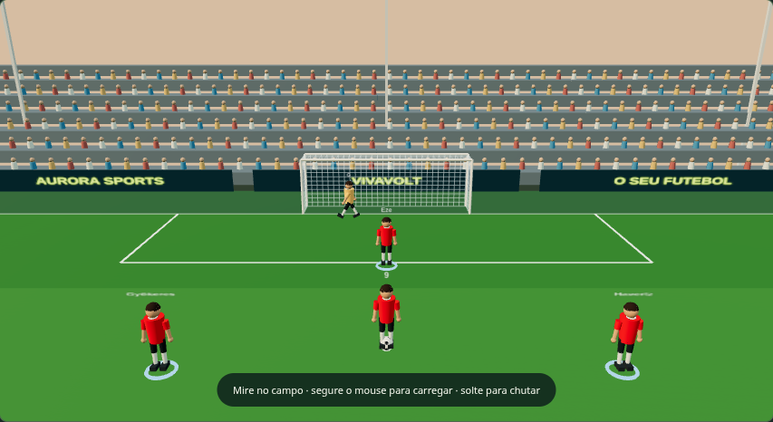

# Próxima Estrela

## Jogar pelo navegador do celular

Versão web preparada para Safari/iPhone e Chrome/Android, com controles por toque e suporte offline após o primeiro carregamento. Não precisa de APK nem de conta Apple Developer.

**Endereço previsto após a publicação:** https://bonne13.github.io/Game-teste/

A publicação usa GitHub Pages. A ativação e a disponibilidade pública ainda precisam ser confirmadas na sua conta; veja [como ativar e jogar](docs/NAVEGADOR.md).

## Testar no Android, sem pagar

**[Baixar APK de teste para Android](https://github.com/Bonne13/Game-teste/blob/main/downloads/ProximaEstrela-Android-teste.apk)** — abra o link no celular, toque em **Download raw**, abra o arquivo e autorize a instalação pelo navegador se o Android solicitar. Não precisa de conta Google Play.

Inclui jogo offline e controles por toque. Android 8.0 ou posterior, com WebView atualizado e WebGL. Veja [como instalar, controles e compilação](docs/ANDROID.md). O APK ainda precisa ser testado num aparelho físico; os controles foram exercitados em Chromium com toque.

## Jogar no Windows

**[Baixar o jogo para Windows 10/11 de 64 bits](https://github.com/Bonne13/Game-teste/raw/refs/heads/main/downloads/ProximaEstrela-Windows-x64.zip)**

1. Baixe o ZIP e extraia os arquivos.
2. Abra `ProximaEstrela-Windows-x64.exe`.
3. O iniciador abre o jogo no navegador padrão. Mantenha sua janela aberta; pressione Enter nela para encerrar.

Não precisa instalar Python, Node.js ou Go para jogar. Os arquivos estão incorporados no executável e funcionam sem internet. Use um navegador com WebGL e aceleração gráfica. A carreira fica salva nesse navegador e computador, no endereço local fixo do iniciador. Uma partida em andamento não é retomada ao fechar. O executável foi compilado para Windows x64; a interface foi testada no Chromium e o servidor incorporado tem testes próprios. A execução nativa no Windows ainda precisa ser confirmada nesse sistema.

Protótipo independente de futebol e carreira para PC, inspirado na experiência de oportunidades e progressão de New Star Soccer e Football Legacy, com nome, interface e modelos próprios. Esta versão traz campos e jogadores em **3D real com Three.js/WebGL**, câmera atrás da bola, gol com rede, goleiro, iluminação e sombras. As animações são simples; não é uma partida completa de onze contra onze.

## Atualização de campo e controles — 0.4.2



- Campo completo de 105 × 68 metros na cena, áreas e marcações em escala, dois gols e arquibancadas com assentos e espectadores modelados.
- Câmera mais baixa e perspectiva mais natural, acompanhando o lance e ficando estável enquanto você carrega o chute. Jogadores com mangas, gola e proporções refinadas.
- **Arrastar para trás é exclusivo dos treinos.** Nas partidas, escolha a mira e solte; a jogada pausa e abre a bola ampliada. Somente um novo toque na bola, segurando e soltando, executa o chute. A carga depende do tempo e da força do jogador, sem depender da distância de arrasto.
- A bola ampliada aparece depois de confirmar a mira e permite escolher contato, altura e curva. Segure nela para carregar a força e solte para chutar; use Voltar e ajustar a mira para cancelar. O botão **Preparar chute** confirma a mira atual sem disparar a jogada.
- Três câmeras, luz de dia/fim de tarde/noite, qualidade Leve/Equilibrada/Alta, quatro estilos de finalização e animações de jogadores, goleiro e rede.

As opções ficam em **Imagem e câmera**, abaixo do menu principal. Os gráficos continuam estilizados e a física é simplificada para este protótipo.

## Controles em 3D

No menu **Treinos**, complete chute, visão, passe, velocidade, técnica e tiro livre. Cada sessão tem cinco tentativas. A média histórica dos seis fundamentos define automaticamente seu clube na liga de preferência, sem influência de dinheiro, reputação ou chuteiras.

**Nos treinos de chute, passe e tiro livre:** primeiro toque no campo para definir a mira e solte. O treino pausa e abre a bola 3D. Em um novo toque, escolha o ponto da bola, segure, arraste para trás e solte para executar. A distância do arrasto define a potência, limitada pela força do jogador. Embaixo aumenta a altura; nas laterais produz curva. Use Voltar para corrigir a mira sem gastar a tentativa.

| Treino | Como jogar |
| --- | --- |
| Chute | Acerte o alvo no gol e evite o goleiro usando o arrasto. |
| Passe | Antecipe o companheiro em movimento e evite interceptações. |
| Visão | Clique no jogador mais livre, ou use teclas/botões 1–4. |
| Velocidade | Alterne A/D ou os botões dos pés, com ritmo de 0,22–0,55 segundo. |
| Técnica | Clique no gramado para conduzir, ou use WASD/setas; atravesse os portões evitando cones. |
| Tiro livre | Use o ponto de contato na bola para contornar a barreira com curva e altura. |

**Nas partidas:** escolha o destino no campo e solte. A jogada pausa e abre uma janela com a bola 3D. Escolha o ponto de contato, segure a bola para carregar e solte para executar. Soltar a mira nunca chuta. Para passes e escanteios, mire no gramado; para chutes, mire no gol. A força depende do tempo segurando e do atributo do jogador. A bola ampliada permite escolher o efeito sem arrastar. Há uma opção para voltar e ajustar a mira.

Em **Jogar**, as chances alternam chute, passe, pênalti, falta, escanteio, cabeceio, voleio e bicicleta. O seletor de jogada permite experimentar as situações. Cabeceio, voleio e bicicleta exigem soltar o mouse na faixa verde do indicador de contato. Passe e escanteio recebidos continuam na mesma chance; a assistência e o gol pertencem aos jogadores envolvidos. Para comandar um companheiro, escolha sua camisa, ative **Movimentar companheiro** e clique no destino no gramado. Desative para voltar a chutar.

## Partidas, intervalo e stamina

Cada tempo tem 45 minutos simulados, mais 1–4 minutos de acréscimos no primeiro e 2–6 no segundo. O relógio avança entre oportunidades e pausa durante uma jogada. A quantidade de chances é sorteada conforme a força efetiva e a intensidade.

| Intensidade | Chances com força 80 | Custo total de stamina |
| --- | --- | --- |
| Leve | 4–6 | 10 |
| Moderada | 5–7 | 20 |
| Alta | 6–8 | 35 |

O cansaço reduz a velocidade. No intervalo obrigatório, você pode abrir a loja completa, comprar e consumir um energético ou refeição, e só então entrar no segundo tempo. Energético custa R$ 60 e recupera até 40 stamina; refeição custa R$ 35 e recupera até 25. Descanso gratuito recupera 30, com bônus da casa e das mobílias. Recuperação limitada a 100; itens não são consumidos com energia cheia. Durante uma jogada não é possível comprar ou recuperar energia.

## Carreira e loja

O menu separa Jogar, Treinos, Carreira, Loja e Ligas e prêmios. As cores acompanham a liga e o clube do jogador. A loja tem Recuperação, Casas, Veículos, Mobílias, Itens pessoais e Chuteiras. Casas oferecem espaços para mobílias; patrimônio influencia o prestígio comercial. Uma chuteira equipada melhora atributos nas partidas, mantendo os treinos e o recrutamento sem bônus de equipamento.

O salário é bruto e **semanal**, pago a cada sete dias do calendário. Rodadas avançam 7, 7, 3 e 4 dias em sequência; partidas próximas não duplicam salários. Valores acumulam proporcionalmente e são quitados ao vencer o contrato. Negociações de aumento e renovação podem ser aceitas ou recusadas, com prazos entre tentativas. Contrato vencido exige renovação ou nova avaliação antes de jogar.

Há três agentes e oito empresas de patrocínio fictícias. Agentes cobram contratação e comissão sobre salários e patrocínios, e melhoram as chances de negociação e renovação. É possível ter até dois patrocinadores simultâneos. O extrato separa salário, patrocínios, bônus e comissões. Negociações de carreira ficam disponíveis entre partidas.

## Ligas, elencos e temporadas

São **12 divisões e 238 clubes**, com nomes reais: primeiras e segundas divisões da Inglaterra, Espanha, Itália, Alemanha, França e Brasil. Referência solicitada: **Europa 2026/27 e Brasil 2026**. O menu permite consultar clubes, nomes, posições, overalls e origem de cada cadastro; essa consulta não escolhe seu clube de carreira.

A base contém **7.170 cadastros de jogadores**, com pelo menos onze nomes por clube. **Os elencos não estão todos confirmados para 2026:** 2.565 cadastros vêm de uma fonte histórica de 2025 e têm o vínculo marcado como pendente; parte da composição das segundas divisões europeias também é auxiliar e ainda precisa de confirmação. Alguns ratings são estimativas. Não há atualização ao vivo. Veja [fontes e limitações](data/SOURCES.md) e [cobertura por clube](data/coverage.json).

O campeonato usa ida e volta, classificação e resultados simulados. Há acesso e rebaixamento entre as duas divisões de cada país; Brasil tem quatro vagas diretas. Na Europa há acessos diretos e playoffs automáticos simplificados em jogo único. Não há terceira divisão. As mudanças preservam clube, atributos, patrimônio e histórico do jogador ao iniciar a temporada seguinte.

Ao fim da temporada, estatísticas simuladas determinam sete prêmios: **Bola de Ouro, Troféu Yashin/Melhor goleiro, Melhor atacante, Melhor defensor, Melhor meio-campo, Chuteira de Ouro e Melhor assistente**. O jogador da carreira concorre e recebe bônus quando vence. Esses vencedores representam a simulação da carreira, não os prêmios reais do mundo atual.

## Executar o código e verificar

Para testar o código em um navegador:

```sh
python3 -m http.server 8000 --bind 127.0.0.1
```

Abra `http://localhost:8000`. Para testar as regras, com Node.js:

```sh
node tests/economy.test.cjs
node tests/leagues.test.cjs
node tests/training.test.cjs
node tests/match.test.cjs
node tests/match-rules.test.cjs
node tests/recovery.test.cjs
node tests/timeline.test.cjs
node tests/world.test.cjs
node tests/drag.test.cjs
node tests/match-input.test.cjs
```

Os testes opcionais `tests/browser.test.cjs` e `tests/match-browser.test.cjs` e `tests/visual-browser.test.cjs` usam Playwright, Chromium com WebGL e o servidor na porta 8000. Verificam gestos reais do mouse, interfaces de treino, recrutamento, elencos, partida, loja no intervalo, recuperação, salário e persistência após promoção.

Para compilar o iniciador com Go 1.27.2 e Python:

```sh
python tools/build-desktop.py
```

O script incorpora os arquivos públicos, testa o servidor e gera EXE/ZIP em `dist/`. `GO_BINARY` permite indicar o compilador. O workflow **Publicar jogo para Windows** também compila no GitHub Actions; tags `v*` publicam uma Release. O ZIP em `downloads/` permite baixar sem esperar a automação.

`match-input.js` separa a carga por tempo das partidas do arrasto dos treinos; `football-presentation.js` contém estádio, qualidade gráfica, câmeras e animações; `football-3d.js` integra as cenas e os controles; `training-engine.js` e `match-engine.js`, as regras de jogadas; `career-economy.js`, economia; `league-world.js`, promoções; `season-awards.js`, estatísticas e prêmios. `club-database.js` é o snapshot offline, gerado por `tools/import-football-data.py`. Three.js está em `vendor/`, com sua licença MIT. Nomes factuais de clubes e jogadores são acompanhados de suas fontes; modelos, marcas comerciais da loja e apresentação foram criados para o protótipo.

Atualização do navegador v0.4.3: se uma aba manteve controles antigos, depois da publicação abra `https://bonne13.github.io/Game-teste/?atualizar=mira-pausada`. O worker atualizado recarrega somente a aba que pediu recuperação e preserva o armazenamento da carreira. As demais abas não são recarregadas automaticamente.
